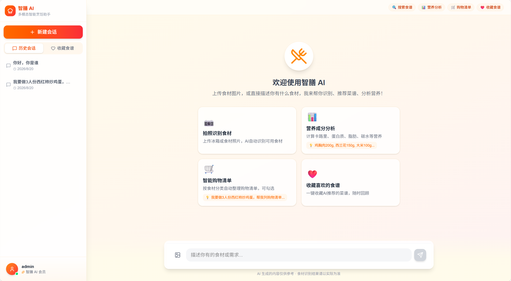
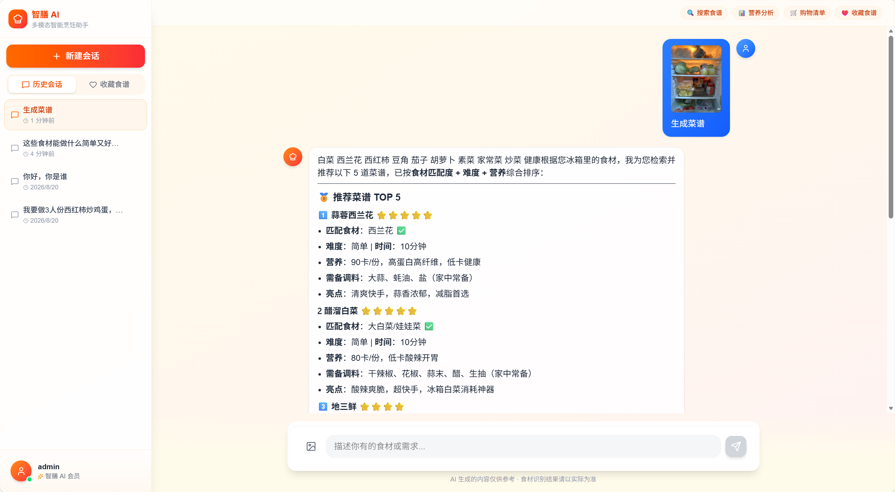
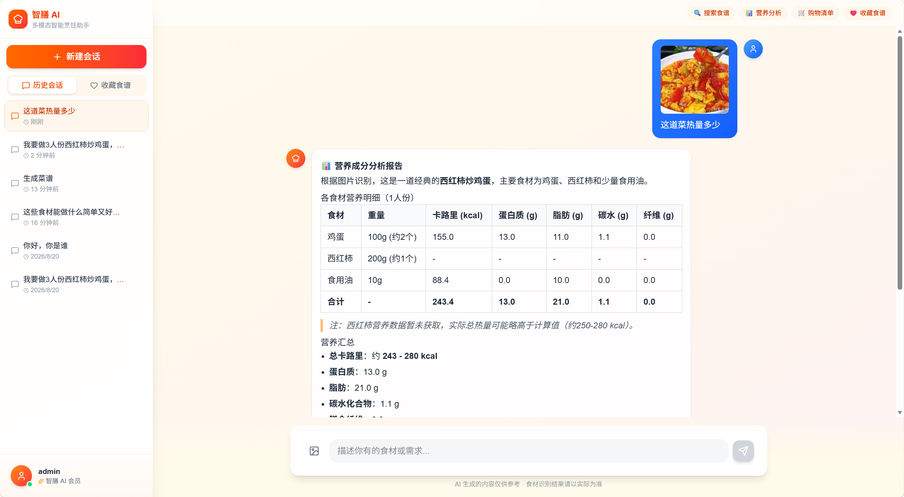
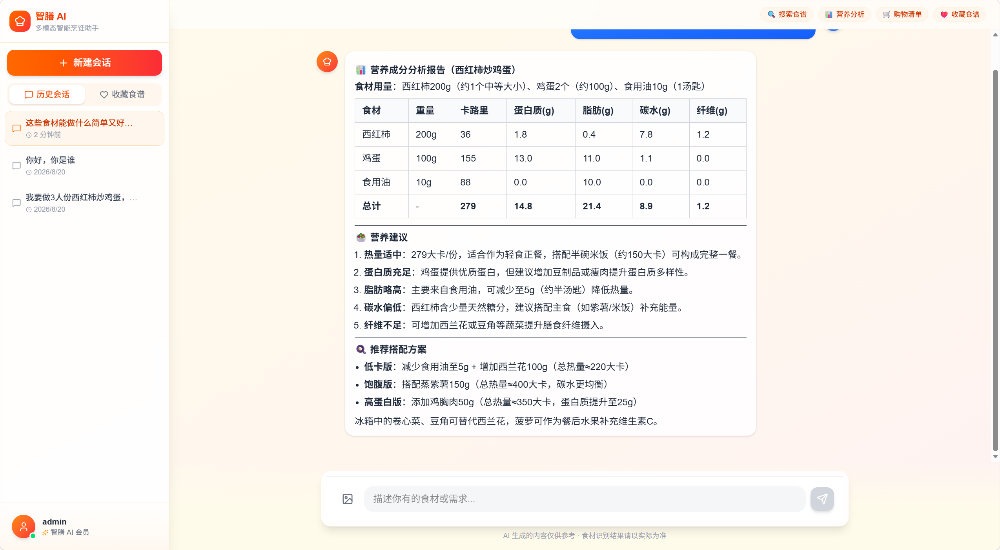
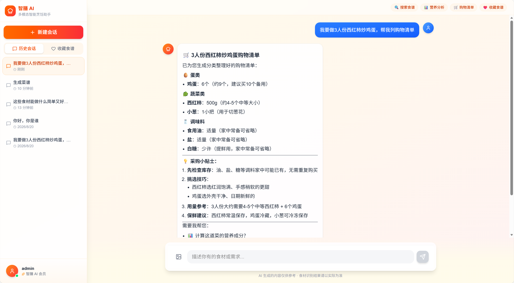
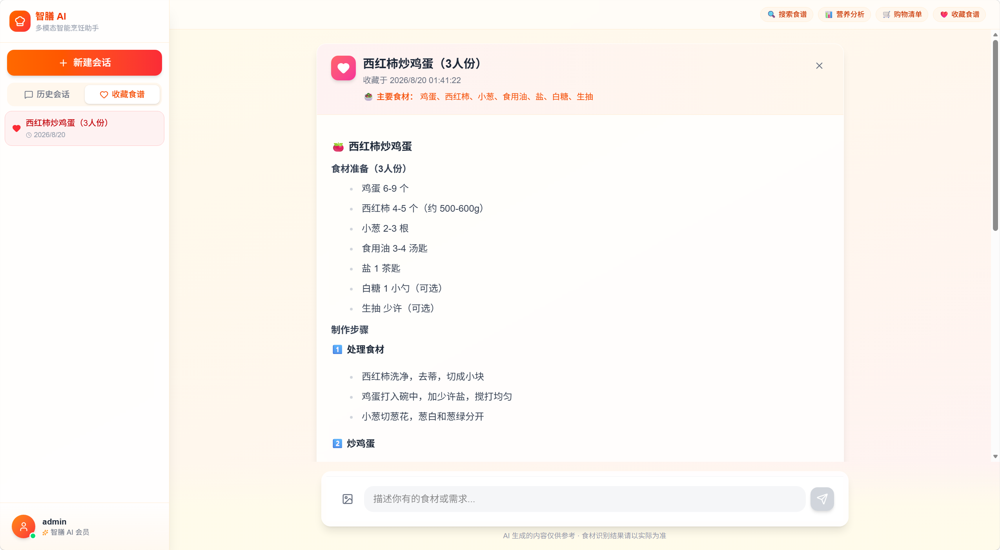
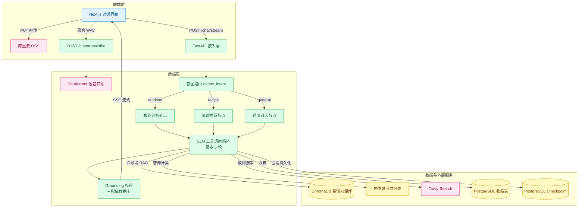
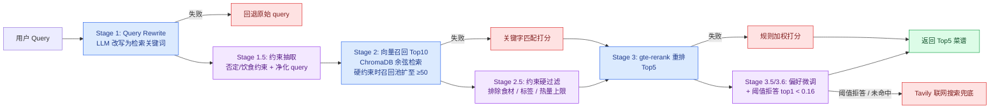
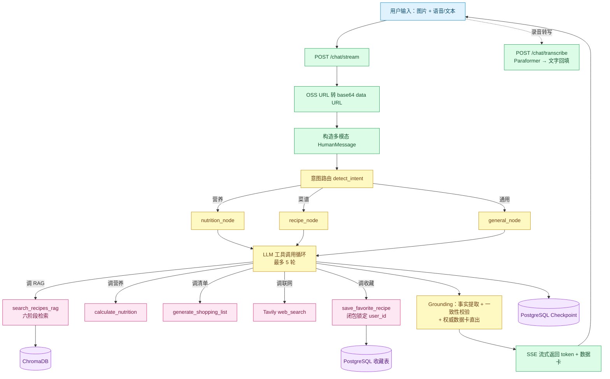

# 智膳 AI｜多模态智能烹饪对话 Agent

[](https://github.com/Wangdake00/zhishan-ai-cooking-agent/actions/workflows/ci.yml)

> 融合多模态大模型、六阶段 RAG 检索、LangGraph 显式 Agent Workflow、确定性 Grounding 防幻觉与工具调用能力的智能烹饪助手——支持图片识食材、语音输入、菜谱推荐、营养计算、购物清单生成与一键收藏。

## 项目简介

智膳 AI 是一个面向日常烹饪场景的多模态对话 Agent 应用。用户可以上传食材照片、语音说话或输入文字需求，系统自动识别意图并调用对应工具（菜谱知识库检索、营养计算、购物清单生成、联网搜索、食谱收藏），以流式方式返回结果。

与普通 Demo 的区别在于：本项目不是用 `create_react_agent` 一把梭，而是基于 LangGraph `StateGraph` 手写了**三路显式工作流**，意图路由、工具集、System Prompt 按节点隔离；同时实现了**闭包级用户身份绑定**、**全链路 RAG 降级**、**工具参数双层防幻觉**、**零额外 LLM 调用的确定性输出接地（Grounding）**等工程化设计，并用 **50 条标注评测集 + 4 种消融模式**量化验证检索质量，保证 Agent 在开放式对话中可控、可用、可度量、不越权。

解决的核心痛点：

- 菜谱推荐与营养计算分散在不同 App，操作割裂
- LLM 直接生成菜谱存在食材用量离谱、收藏越权、数字编造等幻觉风险
- 否定/饮食约束（"不要辣""清真"）在向量空间天然失效，检索结果不可信
- 第三方模型 / 向量库 / 搜索服务任一抖动就导致整条对话中断

## 最近更新

<details open>
<summary><b>更新日志（按日期倒序，点击折叠）</b></summary>

- **2026-10-20 - RAG 检索增强 + 评测体系**
  - 新增约束抽取与硬过滤：否定/饮食约束（"不吃辣""清真""低卡"）规则抽取后走 metadata 硬过滤，有硬约束时召回池自动扩容至 ≥50，解决向量空间对否定语义失效的问题
  - 新增 Rerank 相关性阈值拒答（`0.16`）：依据 50 条评测校准——负例 top1 rerank 分全部 ≤0.179、正例最低 0.173，该阈值可拦截 **9/10 负例**，知识库未命中时不再硬塞结果给 LLM，改走"未找到 + 联网兜底"链路
  - 新增偏好标签微调：偏好标签全量重排后加分，再截断 Top5
  - 新增 `eval/` 评测框架：**50 条**标注用例（40 正例 + 10 负例，覆盖精确菜名/同义词/词序颠倒/食材组合/场景口味/饮食约束/负样本 7 类），支持 **4 种消融模式**（full / no-rewrite / no-rerank / vector-only）对比，输出 Recall@1/3/5、MRR、Hit@5、分项时延与分类别短板报告
- **2026-09-27 - 确定性接地防幻觉层（Grounding）**
  - 新增 `app/agents/grounding.py`：**零额外 LLM 调用**，基于工具返回的结构化事实做正则/集合比对校验——LLM 回答中"总热量"与工具计算偏差 >25% 即报警提示
  - 流末追加"权威数据卡"：营养数据卡、参考菜谱清单由工具事实直接渲染（硬数字不经过 LLM），从源头杜绝数字编造
  - 修复容器重启后历史图片/消息丢失问题
- **2026-09-17 - 语音输入（STT）**
  - 前端 MediaRecorder 录音并转 WAV（16kHz），上传至 `POST /api/v1/chat/transcribe`
  - 后端 DashScope Paraformer（`paraformer-realtime-v2`）转写，中英双语，10MB 上限，同步调用转入线程池执行避免阻塞事件循环
- **2026-09-14 - Docker 一键部署 + 安全加固**
  - 多阶段构建（Node 前端静态导出 → Python 运行时托管），`entrypoint.sh` 自动执行 Alembic 迁移 + RAG 向量库灌入，命名卷持久化重启不重复灌入
  - 迁移 PostgreSQL 17 + SQLAlchemy 2.0 async，完成安全加固：CORS 显式白名单、生产环境弱 JWT 密钥 fail-fast、OSS 预签名鉴权、thread_id 所有权校验防 IDOR、收藏表唯一约束防重复
- **2026-09-07 - 项目初版**
  - LangGraph 三路显式工作流、三阶段 RAG、多模态识图、OSS 预签名直传、SSE 流式输出、收藏/会话管理

</details>

## 数据边界 / 免责声明

> - 菜谱知识库内置 **100 道**常见家常菜，覆盖川、粤、鲁、苏、湘、东北等菜系，用于演示 RAG 检索链路；生产环境需扩充至更大规模知识库。
> - 营养计算基于常见食材每 100g 营养成分表估算，**仅供参考，不构成医学或膳食建议**，特殊饮食需求请咨询专业营养师。
> - 联网搜索结果来自 Tavily，内容质量依赖第三方数据源。
> - 语音转写由 DashScope Paraformer 提供，识别准确率受环境噪声、口音与麦克风质量影响。

## 效果展示

**主对话界面**：侧边栏会话管理 + 四大功能入口卡片，支持图片、语音与文本混合输入。



**识图推荐菜谱**：上传冰箱食材照片，AI 自动识别并按食材匹配度、难度、营养综合排序推荐菜谱。



**识图热量计算**：识别食材并估算各食材及总热量、蛋白质、脂肪、碳水等营养成分。



**菜谱+热量计算**：在推荐菜谱的同时计算该菜品的营养成分，一站式获取做法与热量信息。



**智能购物清单**：按食材分类自动整理购物清单，可勾选已购项。



**收藏列表**：一键收藏 AI 推荐的菜谱，随时回顾做法与用料。



## 项目亮点

- **三路显式 Agent Workflow**：基于 LangGraph StateGraph 构建营养分析 / 菜谱推荐 / 通用对话三个专家节点，关键词意图路由动态切换 System Prompt 与工具集，LLM 在节点内自主决定工具调用顺序与次数（最多 5 轮循环），Checkpoint 持久化使用 `durability="sync"` 确保每个 superstep 落库后再进入下一步
- **六阶段 RAG 检索 + 全链路降级**：Query 改写（失败回退原 query）→ 约束抽取与净化 → ChromaDB 余弦召回 Top10（失败降级关键字匹配）→ 约束硬过滤 → gte-rerank 精排 Top5（失败降级规则加权打分）→ 偏好微调 + 阈值拒答（top1 < 0.16 判定未命中），未命中自动切换 Tavily 联网搜索兜底
- **确定性 Grounding 防幻觉**：零额外 LLM 调用，从 `tool_traces` 提取权威事实（营养数值、RAG 实检菜名），正则校验 LLM 回答一致性（总热量偏差 >25% 报警），流末直出工具渲染的"权威数据卡"，硬数字完全不经过 LLM
- **闭包级用户身份绑定（防越权）**：收藏工具通过闭包在请求进入时锁定真实 `user_id`，工具 schema 完全不暴露该参数，从根源杜绝 LLM 幻觉导致的跨用户收藏；所有会话/收藏接口校验资源所有权
- **语音 + 多模态输入**：MediaRecorder 录音前端转 WAV 后经 Paraformer 转写回填输入框（复用 DashScope Key 零额外密钥）；支持多图 + 文本同条消息，System Prompt 注入用量常识约束（肉类 80~180g、叶菜 80~200g 等 40+ 品类区间），工具函数内部再 clamp 一层
- **Reducer + PostgreSQL Checkpoint 多轮持久化**：`Annotated[list, operator.add]` 实现消息追加不覆盖，`AsyncPostgresSaver` 按 `thread_id` 持久化整个状态快照，新请求自动恢复上下文
- **量化评测驱动检索调优**：50 条标注用例（7 类场景）+ 4 种消融模式对比，Recall@1/3/5、MRR、Hit@5 指标化定位短板类别，阈值 0.16 由评测数据校准而非拍脑袋
- **OSS 预签名直传 + SSE 流式输出**：前端直接 PUT 到阿里云 OSS，后端零带宽转发；FastAPI `StreamingResponse` 逐 token 推送
- **工程化交付**：Docker 多阶段构建一键部署（前端构建 + 依赖安装 + 迁移 + 向量灌入全自动）、生产环境弱密钥 fail-fast、结构化日志、健康/就绪双探针

## 技术架构

### 技术栈

| 分类 | 技术 |
|---|---|
| 后端 | Python 3.13+、FastAPI、Pydantic v2 |
| AI 框架 | LangGraph 1.0、LangChain、langchain-tavily |
| 向量检索 | ChromaDB（余弦相似度空间）、DashScope text-embedding-v3、gte-rerank |
| 语音识别 | DashScope Paraformer（paraformer-realtime-v2） |
| 数据库 | PostgreSQL 17 + SQLAlchemy 2.0 async + asyncpg + Alembic（用户 / 会话 / 收藏 / Checkpoint） |
| 大模型 | 通义千问 qwen3.5-plus（多模态） |
| 外部服务 | 阿里云 OSS、Tavily Search |
| 认证 | JWT（PyJWT）+ bcrypt |
| 前端 | Next.js 16、React 19、TypeScript、Tailwind CSS 4 |
| 流式 | Server-Sent Events (SSE) |
| 部署 | Docker 多阶段构建 + Docker Compose（健康探针 + 命名卷持久化） |
| 包管理 | uv（后端）、npm（前端） |

### 核心架构分层

| 层级 | 关键文件 / 目录 | 职责 |
|---|---|---|
| 接入层 | `app/main.py`、`app/api/v1/` | FastAPI 路由注册、CORS、健康/就绪探针、前端静态托管（含路径遍历防护） |
| 认证层 | `app/core/auth.py`、`app/api/v1/auth.py` | JWT 签发 / 校验、bcrypt 密码哈希、当前用户依赖注入 |
| Agent 编排层 | `app/agents/graph.py` | StateGraph 构建、意图路由、子节点执行、工具循环、Checkpoint 持久化 |
| 防幻觉层 | `app/agents/grounding.py` | 工具事实提取、确定性一致性校验、权威数据卡渲染 |
| RAG 检索层 | `app/rag/pipeline.py`、`app/rag/vector_store.py` | Query 改写、约束抽取/硬过滤、向量召回、Rerank、阈值拒答、全链路降级 |
| 语音层 | `app/api/v1/voice.py` | 音频上传校验（MIME / 10MB）、Paraformer 转写（线程池执行） |
| 工具层 | `app/agents/graph.py`（`@tool` 装饰器） | RAG 检索、营养计算、购物清单、联网搜索、用户级收藏（闭包绑定 user_id） |
| 数据层 | `app/db/` | SQLAlchemy ORM 模型 + 用户、会话、收藏三类异步存储 |
| 评测 | `eval/run_rag_eval.py`、`eval/rag_cases.jsonl` | 50 条标注用例、4 种消融模式、Recall/MRR/Hit 指标 |
| 前端 | `frontend/` | Next.js 对话界面、SSE 流式渲染、录音转写、OSS 直传 |

### 系统数据流



### 数据存储与缓存分工

| 存储 | 实现位置 | 职责 | 设计原因 |
|---|---|---|---|
| PostgreSQL - 用户表 | `app/db/user_store.py` + SQLAlchemy async | 用户名 / 密码哈希 / 注册时间 | 企业级关系型数据库，Alembic 版本化迁移 |
| PostgreSQL - 会话表 | `app/db/session_store.py` | thread_id 与 user_id 映射、会话标题 | `ON CONFLICT` 原子 upsert，会话列表与权限隔离 |
| PostgreSQL - 收藏表 | `app/db/favorite_store.py` | 用户收藏的菜谱内容 | 收藏按用户隔离防越权，`(user_id, title)` 唯一约束防重复 |
| PostgreSQL - Checkpoint | `langgraph-checkpoint-postgres` | LangGraph 状态快照（messages / intent / image_urls 等） | 官方 AsyncPostgresSaver，多轮对话自动恢复 |
| ChromaDB | `db/chroma_data/`（命名卷） | 100 道菜谱的向量索引 + metadata | 本地持久化向量库，显式 `hnsw:space=cosine` 余弦空间 |
| 阿里云 OSS | 外部服务 | 用户上传的食材图片 | 预签名直传，后端零带宽转发；对象键含 user_id 前缀防覆盖 |

### 核心技术流程 —— 六阶段 RAG 检索



**离线阶段**：

1. `recipe_data.py` 定义 100 道菜谱结构化数据（含 tags、热量、食材 metadata，供硬过滤使用）
2. `vector_store.py` 启动时检测 ChromaDB collection 为空，自动调用 DashScope `text-embedding-v3` 批量向量化并灌入（`EMBEDDING_BATCH_SIZE=10`），集合显式配置余弦相似度空间

**在线阶段**：

1. `rewrite_query()`：LLM 将口语化 query 改写为 5~10 个检索关键词
2. `extract_constraints()`：规则抽取否定/饮食硬约束（排除食材、排除标签、热量上限），生成剔除否定短语的净化 query——否定词对 embedding 只有污染
3. `vector_recall()`：ChromaDB 余弦语义召回 Top-K（默认 10）；存在硬约束时召回池扩至 `max(top_k, 50)`，防止过滤后所剩无几
4. `apply_constraints()`：按 metadata 硬过滤（排除食材/标签、热量上限），过滤后全量送 rerank 不提前截断
5. `dashscope_rerank()`：gte-rerank 对候选与净化 query 成对编码重排；偏好标签加权微调后截断 Top-N（默认 5）
6. `阈值拒答`：top1 rerank 分 < `0.16` 判定知识库无相关菜谱（50 条评测校准：负例 top1 全部 ≤0.179、正例最低 0.173），走"未找到 + 联网兜底"链路，不硬塞结果给 LLM
7. 任意阶段异常 → 对应 Fallback，全链路不中断

## 项目结构

```text
ai私厨/
├── app/
│   ├── agents/
│   │   ├── graph.py              # ★ LangGraph StateGraph 核心：图构建、意图路由、子节点、工具循环、Checkpoint
│   │   ├── grounding.py          # ★ 确定性接地防幻觉：事实提取、一致性校验、权威数据卡渲染
│   │   ├── personal_chief.py     # 委托层，对外暴露 search_recipes 等兼容接口
│   │   └── utils.py              # ensure_image_base64_data_url：OSS URL → base64 data URL
│   ├── api/v1/
│   │   ├── auth.py               # 注册 / 登录 / 获取当前用户
│   │   ├── chat.py               # 流式对话 / 历史消息 / 会话 CRUD
│   │   ├── voice.py              # ★ 语音转写：音频上传校验 + DashScope Paraformer（线程池执行）
│   │   ├── favorites.py          # 收藏 CRUD（前端手动收藏）
│   │   └── oss.py                # OSS 预签名 URL 生成（鉴权 + PUT 上传 + GET 访问）
│   ├── core/
│   │   ├── config.py             # Pydantic Settings 统一配置（.env 驱动，生产弱密钥 fail-fast）
│   │   ├── auth.py               # JWT 签发/校验、bcrypt、get_current_user 依赖
│   │   ├── exceptions.py         # 自定义异常体系
│   │   └── handlers.py           # 全局异常处理器
│   ├── common/logger.py          # loguru 日志配置
│   ├── db/
│   │   ├── database.py           # SQLAlchemy async engine + 会话工厂（pool_pre_ping）
│   │   ├── models.py             # ORM 模型（users / sessions / favorites，外键 + 唯一约束）
│   │   ├── user_store.py         # 用户表异步操作（注册捕获 IntegrityError）
│   │   ├── session_store.py      # 会话表 + ON CONFLICT 原子 upsert
│   │   └── favorite_store.py     # 收藏表（按 user_id 隔离）
│   ├── models/schemas.py         # Pydantic 请求 / 响应模型
│   ├── rag/
│   │   ├── pipeline.py           # ★ 六阶段 RAG 检索管道 + 约束过滤 + 阈值拒答 + 全链路降级
│   │   ├── vector_store.py       # ChromaDB 向量库初始化（余弦空间）+ 100 道菜谱自动灌入
│   │   └── recipe_data.py        # 100 道菜谱原始结构化数据
│   └── main.py                   # FastAPI 入口：路由注册、CORS、静态托管、健康/就绪探针
├── eval/
│   ├── run_rag_eval.py           # ★ RAG 评测脚本：4 种消融模式、Recall@1/3/5 / MRR / Hit@5
│   ├── rag_cases.jsonl           # 50 条标注评测集（40 正例 + 10 负例，7 类场景）
│   └── debug_cases.py            # 单条用例调试工具
├── tests/
│   ├── test_quick.py             # StateGraph 架构完整性冒烟测试（无 LLM 调用，秒级）
│   ├── test_rag.py               # RAG 链路测试
│   ├── test_stategraph.py        # LangGraph 状态图测试
│   ├── test_api.py               # API 全链路测试（含会话元数据持久化）
│   └── test_graph_viz.py         # 图结构可视化测试
├── frontend/
│   ├── app/
│   │   ├── layout.tsx            # 全局布局
│   │   ├── page.tsx              # 对话首页（文件路由 = /）
│   │   └── login/page.tsx        # 登录页（文件路由 = /login）
│   ├── components/
│   │   ├── ChatInput.tsx         # 多图上传 + 语音录制（MediaRecorder → WAV）+ 文本输入
│   │   ├── ChatMessage.tsx       # 消息气泡 + Markdown 渲染（含权威数据卡）
│   │   ├── RecipeCard.tsx        # 菜谱卡片
│   │   └── SessionList.tsx       # 左侧会话列表
│   ├── lib/
│   │   ├── api.ts                # 后端 API 封装 + SSE 流式读取 + 语音转写调用
│   │   ├── auth.ts               # JWT token 本地存储与拦截
│   │   └── utils.ts              # 通用工具函数
│   └── types/chat.ts             # TypeScript 类型定义
├── alembic/                      # 数据库迁移脚本（含孤立记录清理）
├── Dockerfile                    # 多阶段构建：Node 前端静态导出 → Python 运行时托管
├── docker-compose.yml            # postgres + app 双服务，健康探针 + 命名卷
├── entrypoint.sh                 # 启动脚本：Alembic 迁移 + RAG 预热 + uvicorn
├── .env.example                  # 环境变量模板
├── pyproject.toml                # 后端依赖（uv 管理）
└── uv.lock
```

## 启动项目

### 环境要求

- Python >= 3.13
- Node.js >= 18
- uv（Python 包管理，推荐）
- Docker + Docker Compose v2（用于 PostgreSQL 与一键部署）

### 1. 克隆并安装依赖

```bash
# 后端
uv sync

# 前端
cd frontend
npm install
```

### 2. 配置环境变量

```bash
cp .env.example .env
# 编辑 .env 填入 DASHSCOPE_API_KEY、TAVILY_API_KEY、OSS_*、JWT_SECRET_KEY
# 本地开发可显式设置 DEBUG=true 以允许默认 JWT 密钥
```

### 3. 启动 PostgreSQL 并执行数据库迁移

```bash
docker compose up -d          # 启动 PostgreSQL 17（读取 .env 中 POSTGRES_* 配置）
uv run alembic upgrade head   # 创建 users / sessions / favorites 业务表
```

### 4. 启动后端

```bash
uv run python -m app.main
# 或
uv run uvicorn app.main:app --reload
```

后端服务地址：`http://127.0.0.1:8001`

### 5. 启动前端

```bash
cd frontend
npm run dev
```

前端开发地址：`http://localhost:3000`

> 注意：语音录制依赖浏览器安全上下文，请使用 `http://localhost:3000` 或 `http://127.0.0.1:8001` 访问，勿用局域网 IP。

### 6. 验证

- 健康检查：`GET http://127.0.0.1:8001/health`
- 就绪探针（校验 PostgreSQL 连通性）：`GET http://127.0.0.1:8001/health/ready`
- API 文档：`http://127.0.0.1:8001/docs`

## Docker 部署

一条命令完成前端构建、后端依赖安装、数据库迁移与 RAG 向量库灌入，适合 Linux 服务器生产部署。

### 前置条件

- 服务器已安装 Docker 20.10+ 与 Docker Compose v2（`docker compose version` 可用）
- 已在服务器上准备好代码仓库
- 已配置 `.env`（只需一份，postgres 与 app 共用）：

```bash
cp .env.example .env
# 必须修改的配置：
# 1. DASHSCOPE_API_KEY / TAVILY_API_KEY / OSS_* —— 换成真实密钥
# 2. JWT_SECRET_KEY —— 换成强随机串（DEBUG=false 时默认弱密钥会拒绝启动）
# 3. POSTGRES_PASSWORD —— 生产环境务必改掉默认密码
# 说明：POSTGRES_HOST 保持 127.0.0.1 即可，compose 会自动覆盖为服务名 postgres
```

### 首次部署

```bash
# 构建镜像并启动（首次会自动执行：npm 前端构建 → uv 安装依赖 → alembic 迁移 → 灌入 100 条菜谱）
docker compose up -d --build

# 观察启动过程（迁移 + RAG 灌入约 1 分钟）
docker compose logs -f app
```

启动完成后验证：

```bash
curl http://127.0.0.1:8001/health         # → {"status":"ok",...}
curl http://127.0.0.1:8001/health/ready   # → {"status":"ready","database":"ok"}
```

浏览器访问 `http://<服务器IP>:8001` 即为前端页面，`/docs` 为 API 文档。

### 更新部署

```bash
git pull
docker compose up -d --build   # 重新构建并滚动替换 app 容器，数据卷不受影响
docker image prune -f          # 可选：清理悬空的旧镜像
```

### 数据持久化

| 命名卷 | 容器路径 | 内容 |
|---|---|---|
| `postgres_data` | `/var/lib/postgresql/data` | 用户 / 会话 / 收藏 / Checkpoint |
| `chroma_data` | `/app/db/chroma_data` | 菜谱向量索引（重启后不重复灌入） |

`docker compose down` 不会删除数据卷；**`docker compose down -v` 会清空全部数据，慎用**。

### 常用运维命令

```bash
docker compose ps                  # 查看服务状态（app 应为 healthy）
docker compose logs -f app         # 跟踪应用日志（含迁移与 RAG 灌入过程）
docker compose restart app         # 重启应用
docker compose exec app alembic upgrade head   # 手动执行数据库迁移
docker compose down                # 停止（保留数据卷）
```

### 常见问题

- **`/health/ready` 返回 503**：PostgreSQL 未就绪或密码不匹配。检查 `docker compose logs postgres`，确认 `.env` 中 `POSTGRES_USER/PASSWORD/DB` 与 postgres 容器一致（首次启动后修改密码需删除 `postgres_data` 卷重建）。
- **容器反复重启，日志报 JWT_SECRET_KEY 错误**：`DEBUG=false` 时禁止默认弱密钥，在 `.env` 中设置强随机 `JWT_SECRET_KEY`（生成方式见 `.env.example`）。
- **日志提示 RAG 预热失败**：检查 `DASHSCOPE_API_KEY` 与服务器出网；此时对话会自动降级（关键字匹配 / 联网搜索），修复密钥后 `docker compose restart app` 即可重新灌入。
- **端口冲突**：宿主机 8001 / 5432 被占用时，在 `.env` 中改 `API_PORT` / `POSTGRES_PORT` 后重新 `up -d`（容器内端口不变）。
- **需要重置向量库**：`docker compose exec app sh -c "rm -rf /app/db/chroma_data/*"` 后重启容器，会重新灌入 100 条菜谱。
- **数据库端口安全**：postgres 仅绑定 `127.0.0.1`，不向公网暴露；远程访问请走 SSH 隧道。

## 环境变量

### 后端（`.env`）

```env
# ========== 服务基础（可选，均有默认值） ==========
# API_HOST=127.0.0.1
# API_PORT=8001
# DEBUG=false                          # 生产保持 false：默认弱 JWT 密钥会拒绝启动
# CORS_ORIGINS=http://localhost:3000,http://127.0.0.1:3000

# ========== 阿里云百炼（大模型 + Embedding + Rerank + ASR） ==========
DASHSCOPE_API_KEY=your_dashscope_api_key_here
DASHSCOPE_BASE_URL=https://dashscope.aliyuncs.com/compatible-mode/v1

# ========== Agent 模型配置 ==========
LLM_MODEL=qwen3.5-plus            # 对话与多模态模型
LLM_TIMEOUT_SECONDS=120
LLM_MAX_RETRIES=2

# ========== RAG / ChromaDB ==========
CHROMA_DB_DIR=db/chroma_data
CHROMA_COLLECTION_NAME=recipes
EMBEDDING_MODEL=text-embedding-v3
EMBEDDING_BATCH_SIZE=10
RERANK_MODEL=gte-rerank
RAG_TOP_K=10                        # 向量召回数量
RAG_TOP_N=5                         # Rerank 后返回数量
RAG_RERANK_THRESHOLD=0.16           # top1 相关性阈值：低于判定知识库未命中，走联网兜底

# ========== 语音识别（STT，复用 DASHSCOPE_API_KEY） ==========
ASR_MODEL=paraformer-realtime-v2

# ========== Tavily（联网搜索兜底） ==========
TAVILY_API_KEY=your_tavily_api_key_here

# ========== JWT 认证 ==========
JWT_SECRET_KEY=your_jwt_secret_key_here   # 生产环境务必更换为强随机串
# JWT_ALGORITHM=HS256
# JWT_EXPIRE_DAYS=7

# ========== PostgreSQL 数据库 ==========
POSTGRES_HOST=127.0.0.1             # Docker 部署时 compose 自动覆盖为服务名 postgres
POSTGRES_PORT=5432
POSTGRES_USER=chief
POSTGRES_PASSWORD=chief123          # 生产环境务必修改
POSTGRES_DB=ai_chef

# ========== 阿里云 OSS（图片存储） ==========
OSS_ACCESS_KEY_ID=your_oss_access_key_id_here
OSS_ACCESS_KEY_SECRET=your_oss_access_key_secret_here
OSS_BUCKET=your_bucket_name
OSS_REGION=cn-shenzhen
OSS_ENDPOINT=oss-cn-shenzhen.aliyuncs.com
```

### 前端

前端通过 `frontend/lib/api.ts` 中硬编码的 `API_BASE` 指向后端，默认 `http://localhost:8001`，本地开发无需额外配置；生产部署走同源托管（Docker 镜像内前端静态产物由 FastAPI 直接服务），天然同源无需跨域。

## 核心接口

| 方法 | 路径 | 说明 | 鉴权 |
|---|---|---|---|
| POST | `/api/v1/auth/register` | 用户注册，返回 JWT | 否 |
| POST | `/api/v1/auth/login` | 用户登录，返回 JWT | 否 |
| GET | `/api/v1/auth/me` | 获取当前登录用户信息 | 是 |
| POST | `/api/v1/chat/stream` | 流式对话（SSE，支持多图） | 是 |
| POST | `/api/v1/chat/transcribe` | 语音转文字（multipart 上传 WAV，≤10MB，中英双语） | 是 |
| GET | `/api/v1/chat/messages` | 获取会话历史消息（校验 thread_id 所有权） | 是 |
| DELETE | `/api/v1/chat/messages` | 清空会话历史 | 是 |
| GET | `/api/v1/chat/sessions` | 列出当前用户所有会话 | 是 |
| DELETE | `/api/v1/chat/sessions/{thread_id}` | 删除指定会话 | 是 |
| GET | `/api/v1/oss/presign` | 获取 OSS 预签名上传 / 访问 URL | 是 |
| POST | `/api/v1/favorites` | 手动创建收藏 | 是 |
| GET | `/api/v1/favorites` | 列出当前用户所有收藏 | 是 |
| GET | `/api/v1/favorites/{favorite_id}` | 获取单条收藏详情 | 是 |
| DELETE | `/api/v1/favorites/{favorite_id}` | 删除收藏 | 是 |
| GET | `/health` | 健康检查（服务状态、版本） | 否 |
| GET | `/health/ready` | 就绪探针（校验 PostgreSQL，失败返回 503） | 否 |

## 测试与验证

```bash
# 后端快速冒烟测试（StateGraph 架构完整性，无 LLM 调用，秒级完成）
uv run python tests/test_quick.py

# RAG 链路测试
uv run python tests/test_rag.py

# LangGraph 状态图测试
uv run python tests/test_stategraph.py

# API 全链路测试（含会话元数据持久化）
uv run python tests/test_api.py
```

RAG 检索质量评测（须在 Docker 容器内运行，宿主机 Windows 直连 embedding API 会卡死）：

```bash
# 完整管道评测：逐条明细 + Recall@1/3/5 / MRR / Hit@5 汇总 + 分类别短板 + 负例误召回观察
docker compose exec app python eval/run_rag_eval.py --mode full

# 4 种消融模式一次跑完，输出对比表（定位改写/Rerank 各阶段的实际贡献）
docker compose exec app python eval/run_rag_eval.py --mode all
```

## 关键业务链路

### 对话主流程



**步骤拆解**：

1. **接入**：前端携带 JWT 调用 `/chat/stream`，传入文本 `message` 与 `image_urls` 列表、`thread_id`；语音输入先经 `/chat/transcribe` 转写为文字回填输入框
2. **图片处理**：后端将 OSS 预签名 URL 下载并转 base64 data URL，保证消息自包含不依赖外链有效期
3. **多模态消息构造**：图片块 + 文本块合并为同一条 `HumanMessage(content=[...])`，支持纯图片无文字输入（自动补默认 prompt）
4. **意图路由**：`detect_intent` 基于关键词匹配判断 nutrition / recipe / general，决定进入哪个专家节点
5. **专家节点执行**：
   - 节点自带专属 System Prompt 与工具集（如营养节点不加载联网搜索工具）
   - `_run_agent_with_tools` 循环：LLM 自主决定是否调工具、调哪个、调几次，最多 5 轮；LLM 调用用 `ainvoke`，同步工具自动转入线程池，不阻塞事件循环
   - 收藏工具通过 `make_save_favorite_tool(user_id)` 闭包生成，`user_id` 锁在函数体内不暴露给 LLM
6. **Grounding 校验**：流结束后从 `tool_traces` 提取权威事实——营养卡（总热量/蛋白/脂肪/碳水 + 未收录食材）与菜谱清单卡由工具事实直接渲染；LLM 回答中"总热量"与工具计算偏差 >25% 时追加校正提示，回答未引用任何实检菜名时提示以清单为准
7. **流式输出**：`graph.astream(..., stream_mode="messages", durability="sync")` 逐 chunk yield，FastAPI `StreamingResponse` 以 `text/event-stream` 推送
8. **状态持久化**：`AsyncPostgresSaver` Checkpoint 按 `thread_id` 自动保存整个 state，下次请求带同一 `thread_id` 自动恢复历史上下文
