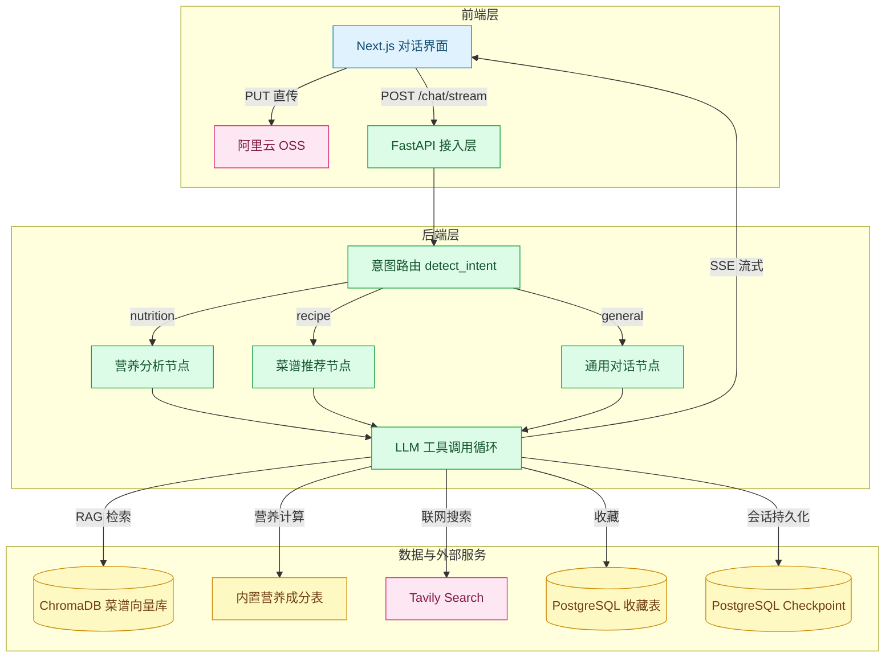
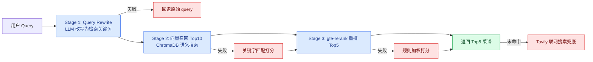
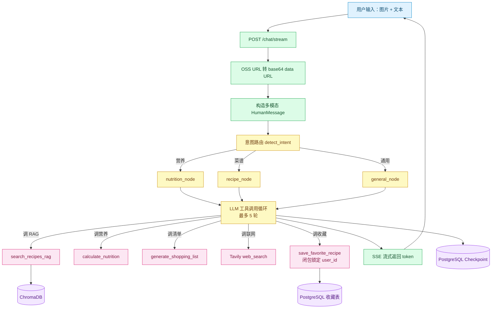

# 智膳 AI｜多模态智能烹饪对话 Agent

> 融合多模态大模型、三阶段 RAG 检索、LangGraph 显式 Agent Workflow 与工具调用能力的智能烹饪助手——支持图片识食材、菜谱推荐、营养计算、购物清单生成与一键收藏。

## 项目简介

智膳 AI 是一个面向日常烹饪场景的多模态对话 Agent 应用。用户可以上传食材照片或输入文字需求，系统自动识别意图并调用对应工具（菜谱知识库检索、营养计算、购物清单生成、联网搜索、食谱收藏），以流式方式返回结果。

与普通 Demo 的区别在于：本项目不是用 `create_react_agent` 一把梭，而是基于 LangGraph `StateGraph` 手写了**三路显式工作流**，意图路由、工具集、System Prompt 按节点隔离；同时实现了**闭包级用户身份绑定**、**全链路 RAG 降级**、**工具参数双层防幻觉**等工程化设计，保证 Agent 在开放式对话中可控、可用、不越权。

解决的核心痛点：
- 菜谱推荐与营养计算分散在不同 App，操作割裂
- LLM 直接生成菜谱存在食材用量离谱、收藏越权等幻觉风险
- 第三方模型 / 向量库 / 搜索服务任一抖动就导致整条对话中断


## 数据边界 / 免责声明

> - 菜谱知识库内置 **100 道**常见家常菜，覆盖川、粤、鲁、苏、湘、东北等菜系，用于演示 RAG 检索链路；生产环境需扩充至更大规模知识库。
- 营养计算基于常见食材每 100g 营养成分表估算，**仅供参考，不构成医学或膳食建议**，特殊饮食需求请咨询专业营养师。
- 联网搜索结果来自 Tavily，内容质量依赖第三方数据源。

## 效果展示

**主对话界面**：侧边栏会话管理 + 四大功能入口卡片，支持图片与文本混合输入。


**识图推荐菜谱**：上传冰箱食材照片，AI 自动识别并按食材匹配度、难度、营养综合排序推荐菜谱。


**识图热量计算**：识别食材并估算各食材及总热量、蛋白质、脂肪、碳水等营养成分。


**菜谱+热量计算**：在推荐菜谱的同时计算该菜品的营养成分，一站式获取做法与热量信息。


**智能购物清单**：按食材分类自动整理购物清单，可勾选已购项。


**收藏列表**：一键收藏 AI 推荐的菜谱，随时回顾做法与用料。


## 项目亮点

- **三路显式 Agent Workflow**：基于 LangGraph StateGraph 构建营养分析 / 菜谱推荐 / 通用对话三个专家节点，关键词意图路由动态切换 System Prompt 与工具集，LLM 在节点内自主决定工具调用顺序与次数（最多 5 轮循环）
- **闭包级用户身份绑定（防越权）**：收藏工具通过闭包在请求进入时锁定真实 `user_id`，工具 schema 完全不暴露该参数，从根源杜绝 LLM 幻觉导致的跨用户收藏
- **Reducer + PostgreSQL Checkpoint 多轮持久化**：`Annotated[list, operator.add]` 实现消息追加不覆盖，`AsyncPostgresSaver` 按 `thread_id` 持久化整个状态快照，新请求自动恢复上下文
- **三阶段 RAG 检索 + 全链路降级**：Query Rewrite（失败回退原 query）→ ChromaDB 向量召回 Top10（失败降级关键字匹配）→ gte-rerank 精排 Top5（失败降级规则加权打分），知识库未命中时自动切换 Tavily 联网搜索兜底
- **多模态输入与工具参数双层防幻觉**：支持多图 + 文本同条消息输入，System Prompt 注入用量常识约束（肉类 80~180g、叶菜 80~200g 等 40+ 品类区间），工具函数内部再 clamp 一层
- **OSS 预签名直传 + SSE 流式输出**：前端直接 PUT 到阿里云 OSS，后端零转发；FastAPI `StreamingResponse` 逐 token 推送给前端

## 技术架构

### 技术栈

| 分类 | 技术 |
|---|---|
| 后端 | Python 3.13+、FastAPI、Pydantic v2 |
| AI 框架 | LangGraph、LangChain、langchain-tavily |
| 向量检索 | ChromaDB、DashScope text-embedding-v3、gte-rerank |
| 数据库 | PostgreSQL 17 + SQLAlchemy 2.0 async + Alembic（用户 / 会话 / 收藏 / Checkpoint） |
| 大模型 | 通义千问 qwen3.5-plus（多模态） |
| 外部服务 | 阿里云 OSS、Tavily Search |
| 认证 | JWT + bcrypt |
| 前端 | Next.js 16、React 19、TypeScript、Tailwind CSS 4 |
| 流式 | Server-Sent Events (SSE) |
| 包管理 | uv（后端）、npm（前端） |

### 核心架构分层

| 层级 | 关键文件 / 目录 | 职责 |
|---|---|---|
| 接入层 | `app/main.py`、`app/api/v1/` | FastAPI 路由注册、CORS、健康检查、前端静态托管 |
| 认证层 | `app/core/auth.py`、`app/api/v1/auth.py` | JWT 签发 / 校验、bcrypt 密码哈希、当前用户依赖注入 |
| Agent 编排层 | `app/agents/graph.py` | StateGraph 构建、意图路由、子节点执行、Checkpoint 持久化 |
| RAG 检索层 | `app/rag/pipeline.py`、`app/rag/vector_store.py` | Query 改写、向量召回、Rerank 重排、全链路降级 |
| 工具层 | `app/agents/graph.py`（`@tool` 装饰器） | RAG 检索、营养计算、购物清单、联网搜索、用户级收藏 |
| 数据层 | `app/db/` | SQLAlchemy ORM 模型 + 用户、会话、收藏三类异步存储 |
| 前端 | `frontend/` | Next.js 对话界面、SSE 流式渲染、OSS 直传 |

### 系统数据流



### 数据存储与缓存分工

| 存储 | 实现位置 | 职责 | 设计原因 |
|---|---|---|---|
| PostgreSQL - 用户表 | `app/db/user_store.py` + SQLAlchemy async | 用户名 / 密码哈希 / 注册时间 | 企业级关系型数据库，Alembic 版本化迁移 |
| PostgreSQL - 会话表 | `app/db/session_store.py` | thread_id 与 user_id 映射、会话标题 | `ON CONFLICT` 原子 upsert，会话列表与权限隔离 |
| PostgreSQL - 收藏表 | `app/db/favorite_store.py` | 用户收藏的菜谱内容 | 收藏按用户隔离，防越权查询 |
| PostgreSQL - Checkpoint | `langgraph-checkpoint-postgres` | LangGraph 状态快照（messages / intent / image_urls 等） | 官方 AsyncPostgresSaver，多轮对话自动恢复 |
| ChromaDB | `db/chroma_data/` | 100 道菜谱的向量索引 + metadata | 本地持久化向量库，支持语义检索 |
| 阿里云 OSS | 外部服务 | 用户上传的食材图片 | 预签名直传，后端零带宽转发 |

### 核心技术流程 —— 三阶段 RAG 检索



**离线阶段**：
1. `recipe_data.py` 定义 100 道菜谱结构化数据
2. `vector_store.py` 启动时检测 ChromaDB collection 为空，自动调用 DashScope `text-embedding-v3` 批量向量化并灌入（`EMBEDDING_BATCH_SIZE=10`）

**在线阶段**：
1. `rewrite_query()`：LLM 将口语化 query 改写为 5~10 个检索关键词
2. `vector_recall()`：ChromaDB 语义召回 Top-K（默认 10），相似度 = `1 - distance/2`
3. `dashscope_rerank()`：gte-rerank 对候选与 query 成对编码重排，取 Top-N（默认 5）
4. 任意阶段异常 → 对应 Fallback，全链路不中断

## 项目结构

```text
ai私厨/
├── app/
│   ├── agents/
│   │   ├── graph.py              # ★ LangGraph StateGraph 核心：图构建、意图路由、子节点、Checkpoint
│   │   ├── personal_chief.py     # 委托层，对外暴露 search_recipes 等兼容接口
│   │   └── utils.py              # ensure_image_base64_data_url：OSS URL → base64 data URL
│   ├── api/v1/
│   │   ├── auth.py               # 注册 / 登录 / 获取当前用户
│   │   ├── chat.py               # 流式对话 / 历史消息 / 会话 CRUD
│   │   ├── favorites.py          # 收藏 CRUD（前端手动收藏）
│   │   └── oss.py                # OSS 预签名 URL 生成（PUT 上传 + GET 访问）
│   ├── core/
│   │   ├── config.py             # Pydantic Settings 统一配置（.env 驱动）
│   │   ├── auth.py               # JWT 签发/校验、bcrypt、get_current_user 依赖
│   │   ├── exceptions.py         # 自定义异常类
│   │   └── handlers.py           # 全局异常处理器
│   ├── common/logger.py          # loguru 日志配置
│   ├── db/
│   │   ├── database.py           # SQLAlchemy async engine + 会话工厂
│   │   ├── models.py             # ORM 模型（users / sessions / favorites）
│   │   ├── user_store.py         # 用户表异步操作
│   │   ├── session_store.py      # 会话表 + ON CONFLICT 原子 upsert
│   │   └── favorite_store.py     # 收藏表（按 user_id 隔离）
│   ├── models/schemas.py         # Pydantic 请求 / 响应模型
│   ├── rag/
│   │   ├── pipeline.py           # ★ 三阶段 RAG 检索管道 + 全链路降级
│   │   ├── vector_store.py       # ChromaDB 向量库初始化 + 100 道菜谱自动灌入
│   │   └── recipe_data.py        # 100 道菜谱原始结构化数据
│   └── main.py                   # FastAPI 入口：路由注册、CORS、静态托管、健康检查
├── frontend/
│   ├── app/
│   │   ├── layout.tsx            # 全局布局
│   │   ├── page.tsx              # 对话首页（文件路由 = /）
│   │   └── login/page.tsx        # 登录页（文件路由 = /login）
│   ├── components/
│   │   ├── ChatInput.tsx         # 多图上传 + 文本输入框
│   │   ├── ChatMessage.tsx       # 消息气泡 + Markdown 渲染
│   │   ├── RecipeCard.tsx        # 菜谱卡片
│   │   └── SessionList.tsx       # 左侧会话列表
│   ├── lib/
│   │   ├── api.ts                # 后端 API 封装 + SSE 流式读取
│   │   ├── auth.ts               # JWT token 本地存储与拦截
│   │   └── utils.ts              # 通用工具函数
│   └── types/chat.ts             # TypeScript 类型定义
├── .env.example                  # 环境变量模板
├── pyproject.toml                # 后端依赖（uv 管理）
└── uv.lock
```

## 启动项目

### 环境要求

- Python >= 3.13
- Node.js >= 18
- uv（Python 包管理，推荐）

### 1. 克隆并安装依赖

```bash
# 后端
uv sync

# 前端
cd frontend
npm install
```

### 2. 配置环境变量

```bash
cp .env.example .env
# 编辑 .env 填入 DASHSCOPE_API_KEY、TAVILY_API_KEY、OSS_*、JWT_SECRET_KEY
```

### 3. 启动 PostgreSQL 并执行数据库迁移

```bash
docker compose up -d          # 启动 PostgreSQL 17（读取 .env 中 POSTGRES_* 配置）
uv run alembic upgrade head   # 创建 users / sessions / favorites 业务表
```

### 4. 启动后端

```bash
uv run python -m app.main
# 或
uv run uvicorn app.main:app --reload
```

后端服务地址：`http://127.0.0.1:8001`

### 5. 启动前端

```bash
cd frontend
npm run dev
```

前端开发地址：`http://localhost:3000`

### 5. 验证

- 健康检查：`GET http://127.0.0.1:8001/health`
- API 文档：`http://127.0.0.1:8001/docs`

## 环境变量

### 后端（`.env`）

```env
# ========== 阿里云百炼（大模型 + Embedding + Rerank） ==========
DASHSCOPE_API_KEY=your_dashscope_api_key_here
DASHSCOPE_BASE_URL=https://dashscope.aliyuncs.com/compatible-mode/v1

# ========== Agent 模型配置 ==========
LLM_MODEL=qwen3.5-plus            # 对话与多模态模型
LLM_TIMEOUT_SECONDS=120
LLM_MAX_RETRIES=2

# ========== RAG / ChromaDB ==========
CHROMA_DB_DIR=db/chroma_data
CHROMA_COLLECTION_NAME=recipes
EMBEDDING_MODEL=text-embedding-v3
EMBEDDING_BATCH_SIZE=10
RERANK_MODEL=gte-rerank
RAG_TOP_K=10                        # 向量召回数量
RAG_TOP_N=5                         # Rerank 后返回数量

# ========== Tavily（联网搜索兜底） ==========
TAVILY_API_KEY=your_tavily_api_key_here

# ========== JWT 认证 ==========
JWT_SECRET_KEY=your_jwt_secret_key_here   # 生产环境务必更换

# ========== 阿里云 OSS（图片存储） ==========
OSS_ACCESS_KEY_ID=your_oss_access_key_id_here
OSS_ACCESS_KEY_SECRET=your_oss_access_key_secret_here
OSS_BUCKET=your_bucket_name
OSS_REGION=cn-shenzhen
OSS_ENDPOINT=oss-cn-shenzhen.aliyuncs.com
```

### 前端

前端通过 `lib/api.ts` 中配置的 `API_BASE_URL` 指向后端，默认 `http://localhost:8001/api/v1`，开发环境无需额外配置。

## 核心接口

| 方法 | 路径 | 说明 | 鉴权 |
|---|---|---|---|
| POST | `/api/v1/auth/register` | 用户注册，返回 JWT | 否 |
| POST | `/api/v1/auth/login` | 用户登录，返回 JWT | 否 |
| GET | `/api/v1/auth/me` | 获取当前登录用户信息 | 是 |
| POST | `/api/v1/chat/stream` | 流式对话（SSE，支持多图） | 是 |
| GET | `/api/v1/chat/messages` | 获取会话历史消息 | 是 |
| DELETE | `/api/v1/chat/messages` | 清空会话历史 | 是 |
| GET | `/api/v1/chat/sessions` | 列出当前用户所有会话 | 是 |
| DELETE | `/api/v1/chat/sessions/{thread_id}` | 删除指定会话 | 是 |
| GET | `/api/v1/oss/presign` | 获取 OSS 预签名上传 / 访问 URL | 否 |
| POST | `/api/v1/favorites` | 手动创建收藏 | 是 |
| GET | `/api/v1/favorites` | 列出当前用户所有收藏 | 是 |
| GET | `/api/v1/favorites/{favorite_id}` | 获取单条收藏详情 | 是 |
| DELETE | `/api/v1/favorites/{favorite_id}` | 删除收藏 | 是 |
| GET | `/health` | 健康检查 | 否 |

## 测试与验证

```bash
# 后端快速冒烟测试
uv run python test_quick.py

# RAG 链路测试
uv run python test_rag.py

# LangGraph 状态图测试
uv run python test_stategraph.py
```

## 关键业务链路

### 对话主流程



**步骤拆解**：

1. **接入**：前端携带 JWT 调用 `/chat/stream`，传入文本 `message` 与 `image_urls` 列表、`thread_id`
2. **图片处理**：后端将 OSS 预签名 URL 下载并转 base64 data URL，保证消息自包含不依赖外链有效期
3. **多模态消息构造**：图片块 + 文本块合并为同一条 `HumanMessage(content=[...])`，支持纯图片无文字输入（自动补默认 prompt）
4. **意图路由**：`detect_intent` 基于关键词匹配判断 nutrition / recipe / general，决定进入哪个专家节点
5. **专家节点执行**：
   - 节点自带专属 System Prompt 与工具集（如营养节点不加载联网搜索工具）
   - `_run_agent_with_tools` 循环：LLM 自主决定是否调工具、调哪个、调几次，最多 5 轮
   - 收藏工具通过 `make_save_favorite_tool(user_id)` 闭包生成，`user_id` 锁在函数体内不暴露给 LLM
6. **流式输出**：`graph.astream(..., stream_mode="messages")` 逐 chunk yield，FastAPI `StreamingResponse` 以 `text/event-stream` 推送
7. **状态持久化**：`AsyncPostgresSaver` Checkpoint 按 `thread_id` 自动保存整个 state，下次请求带同一 `thread_id` 自动恢复历史上下文
